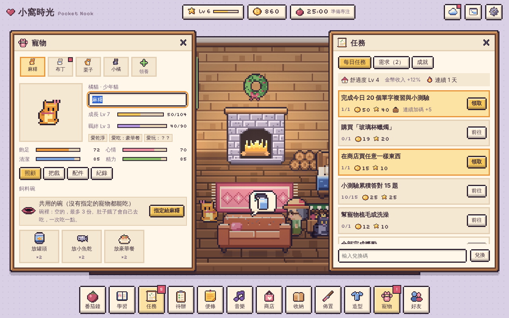
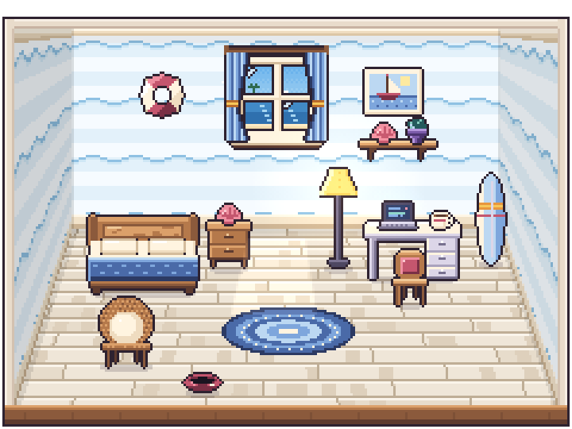
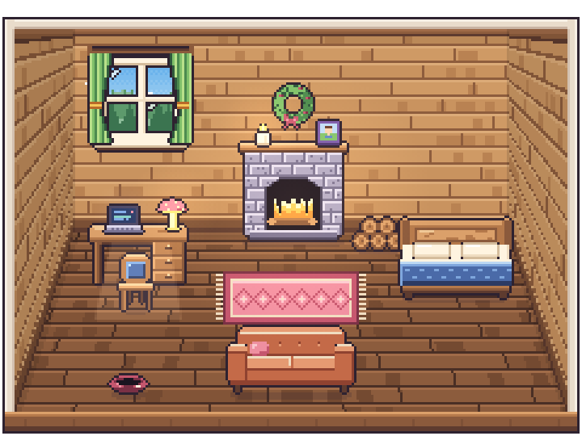
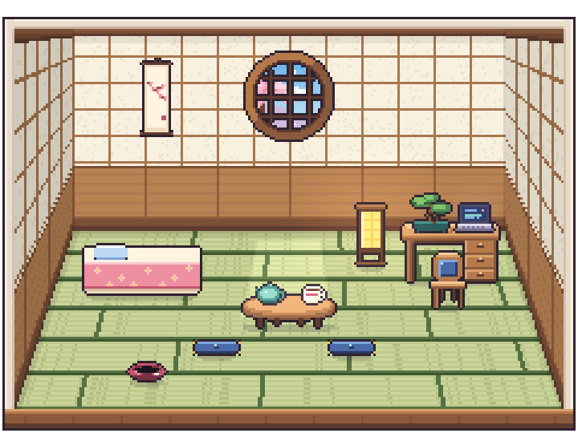
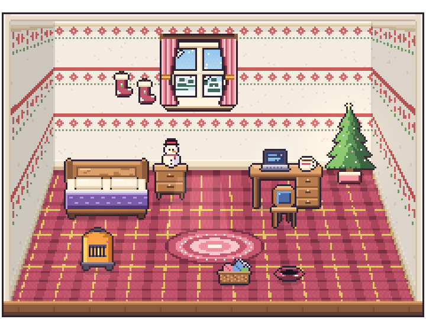
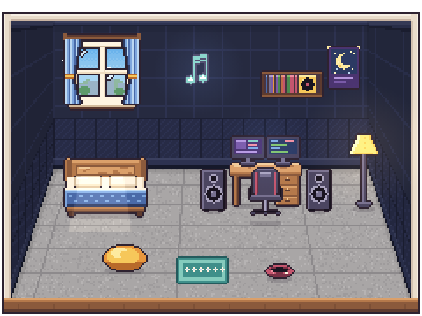
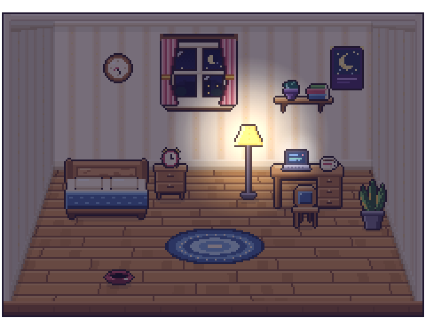

# 小窩時光 Pocket Nook



像素風的 Lo-Fi 學習與專注小遊戲：每天複習 20 個高中英文單字，照顧房間裡的貓咪和植物，用番茄鐘專注賺金幣，把小房間佈置成自己喜歡的樣子。

純 HTML、CSS、JavaScript，不需要任何建置工具，放上 GitHub Pages 就能玩。所有家具、角色、寵物和圖示都是像素圖，原始檔在 `assets/sprites/`，可以直接拿去改。

## 功能

### 學習
- **6,864 個英文單字**（Level 1–6，約 1,100 個一級），每個字都有詞性、中文和 KK 音標。可以在「學習」勾選要出哪幾級的新字。
- **每日任務**：每天複習 20 個字（翻卡片，可以按「上一個」或 Backspace 回頭看），一次 5 個，看完 5 個可以先休息、晚點再回來接著看；20 個看完再做 10 題小測驗（測驗時不能回頭），完成後領每日獎勵；連續天數越多，獎勵越多。
- **幸運題**：答對時偶爾會遇到幸運題，隨機得到一點金幣、經驗、寵物零食，或幫團隊多一顆星；訓練寵物和為寵物答的題，還可能增加羈絆。
- **題目難度會跟著你調整**：最近答得很順，會多出一點新字和拼字題；最近比較卡，會多出熟悉的字和選擇題。自己選「困難」的每日挑戰不受影響。訓練寵物連續失敗時，下一次會出你比較熟的字。
- **四種題型**：看英文選中文、看中文選英文、拼字、聽發音選中文。發音預設用瀏覽器內建語音；有真人音檔的話見下方「單字音檔」。
- **間隔複習**：答對的字隔 1、2、4、7、15 天再出現，答錯的字隔天再考；新字和該複習的字會自動排進每天的 20 個。
- **自由練習**：隨時再練 10 個字，每天最多賺 40 金幣。
- **單字本**：搜尋、依程度和熟練度篩選、聽發音。

### 房間裡的需求
房間裡會不時冒出泡泡，代表有東西需要你：

| 需求 | 需要的道具或行動 |
| --- | --- |
| 寵物肚子餓（飽足度會隨時間下降） | 罐頭、小魚乾或豪華餐，寵物會走到碗旁邊吃 |
| 寵物好無聊（心情太低） | 貓薄荷，或用逗貓棒、毛線球、小皮球陪牠玩 |
| 寵物身上髒髒的（清潔度太低） | 洗毛精洗澡，或用梳子梳毛 |
| 寵物不太舒服（餓太久或太髒會生病） | 寵物藥 |
| 寵物撒嬌／想被摸摸 | 零食／點牠三下 |
| 寵物想學新把戲 | 到寵物視窗訓練一次 |
| 寵物想要坐墊、貓跳台等家具 | 把那件家具擺出來（沒有就去商店買） |
| 植物葉子枯黃 | 植物營養液 |
| 家具積灰塵 | 清潔噴霧 |
| 燈泡燒壞（燈打不開） | 燈泡 |
| 角色肚子餓／想睡 | 飯糰（下一輪專注金幣 +30%）／咖啡（經驗 +30%） |
| 想佈置房間、房間太暗、外面天氣很好 | 擺一件家具、開燈、拉開窗簾 |

道具可以用**複習 5 個單字**換（答對 3 題得 1 個，全對得 2 個），也可以用金幣在商店買。完成需求會得到金幣、經驗，照顧寵物還會增加羈絆。

### 成長與經濟
- **金幣是最主要的目標**：家具、壁紙、地板、角色款式、寵物、用品都要用金幣買，等級只決定商店裡開放哪些東西（家具 Lv 1–28、壁紙地板 Lv 1–25、角色款式 Lv 2–30）。全部收集完大約要 19 萬金幣。
- **金幣來源**：專注（每分鐘）、完成一輪專注、小測驗、每日任務、全部完成獎勵、需求、成就、待辦、寵物羈絆升級、寵物叼來的禮物、升級禮物、掛機收入。
- **經驗來源**：專注、小測驗、新學會的字、每日任務、需求、成就、待辦。
- **道具來源**：學習換取、商店、每日任務、成就、升級禮物盒、寵物禮物。
- **每日任務**：每天 5 個：「今日單字」、「購買某件家具」、2 個英文挑戰、1 個生活任務，全部完成再加碼。
  - 英文挑戰從這 4 種抽：拼字挑戰（普通 8 個字有字首和字數提示／困難 10 個沒有提示）、聽力挑戰（10 個字，普通聽音選中文／困難聽音直接拼）、錯字複習（之前答錯的字，普通 8 個選擇題／困難 12 個混合拼字；答錯過的字有 6 個以上才會出現）、新程度單字（目前程度高一級的字，先看卡片再測驗，普通 6 個／困難 10 個）。字庫用你學過的字和今天的 20 個字。
  - 生活任務也要過單字小測驗：訓練寵物成功（普通 1 次／困難 2 次），或在「學習」複習 5 個單字換道具（普通換到 1 次／困難 2 次，而且要全對才算）。
  - 這 3 個任務開始前先選普通或困難，困難獎勵 ×1.5；選了（或已經有進度）當天就不能改。英文挑戰不計時，答錯不用重來，最後會把答錯的字再出一次，可以中途離開，答對的字都會留著。
- **成就**：學會單字、精熟單字、連續天數、測驗答對數、專注時數、需求、羈絆、寵物數量、寵物成長、把戲、佈置、累積金幣，共 12 種、多個階段；部分階段送限定家具（學霸獎盃、單字達人獎狀）。
- **舒適度**：房間裡擺的東西越多越好，每升一級專注、測驗、任務、需求等金幣收入 +3%（最多 +30%），掛機收入也會增加。

### 寵物
- **一起養**：最多養 10 隻（5 種貓，同一種也可以養好幾隻；v0.91 起只有貓咪，舊存檔裡的柴犬會變成顏色最接近的貓，名字、等級、感情和把戲都保留），房間裡同時最多 5 隻，其他的住在寵物旅館（不會餓、不會有需求），隨時可以換。
- **四種狀態**：飽足、心情、清潔、精力。玩耍和訓練消耗精力，睡覺會恢復；餓太久或太髒會生病，要吃寵物藥。關掉遊戲時狀態下降得比較慢，也不會因此生病。
- **成長**：照顧、玩耍、訓練、滿足需求都會給寵物經驗，Lv 1–4 是幼貓、5–9 少年、10 以上成年，最高 Lv 20，升級送金幣。
- **個性與喜好**：每隻都有一種個性（貪吃、黏人、活潑、愛睡、愛乾淨、好奇），會影響狀態變化和行為；還有最喜歡的食物和玩具，餵到或玩到時才會發現，效果 1.5 倍。
- **把戲**：坐下（Lv 1）、握手（Lv 3）、轉圈圈（Lv 5）、後空翻（Lv 7）、中槍（Lv 9）、喬登三段跳（Lv 11）、跳火圈（Lv 13）、麥可舞步45度傾斜（Lv 15）。訓練一次要答 4 題單字小測驗，答對 3 題算成功；學會後按「表演」，寵物會在房間裡真的做出動作，主人也會走過來一起演：握手時伸手、中槍時比出手槍「砰！」、跳火圈時舉起火圈、跳舞時有帽子和聚光燈。番茄鐘專注中主人不離開書桌，寵物自己表演（火圈會放在架子上）。每天第一次表演有金幣。舊存檔的翻滾、跳高、跳舞進度會轉到後空翻、喬登三段跳、麥可舞步。
- **用品與配件**：梳子、逗貓棒、毛線球、小皮球買一次就能一直用；項圈、鈴鐺、領巾、蝴蝶結、小花、小王冠會畫在寵物身上，買一次所有寵物都能戴。
- **親手照顧**：房間左下角的「手邊」（手機在房間下方），或寵物視窗、需求卡上的「拿起…」按鈕，可以把食物、零食、梳子、洗毛精、寵物藥、玩具拿在手上，再到房間裡對寵物用：點牠餵食；拿零食牠會先坐好討；梳子要在牠身上來回刷幾下；洗完澡牠會甩水；食物也可以點碗放進去。按「放下」、右鍵或 Esc 放下。效果、價格和每日上限跟原本一樣。
- **陪玩**：逗貓棒在房間裡晃，寵物會追著羽毛撲；小皮球丟到地上，柴犬會叼回主人腳邊，貓咪會把球拍來拍去；毛線球貓咪會抱著打滾，柴犬會用鼻子推；貓薄荷讓貓咪翻肚打滾，柴犬聞了會打噴嚏。愛睏或精力低的寵物追一下就累了。
- **寵物自己的小習慣**（不影響數值）：貓咪會鑽進紙箱只露出頭、在軟的地方睡前先踩一踩、到貓抓柱或貓跳台磨爪、拍拍盆栽；寵物會在地毯上翻肚打滾；柴犬會把球叼到窩裡，主人專注時趴在腳邊；擺出新家具時，寵物會過去聞一聞、繞一圈。待最久的家具會變成牠「最愛的地方」，寫在寵物視窗的「紀錄」裡。商店新增紙箱、寵物窩、貓抓柱。
- **羈絆**：摸摸、餵食、陪玩會增加羈絆，升級送金幣和零食，Lv 2 之後寵物偶爾會叼禮物給你（好奇的寵物和會越多把戲的寵物更常叼）。
- **隱藏習慣**：共 20 種（窗邊發呆、睡前轉圈、喜歡角落、巡邏、偷看主人、喜歡高處、飯後整理、跟著同伴、喜歡地毯、看魚、聽音樂、看雨、找暖光、躲桌下、伸懶腰、聞新物件、回頭確認、坐姿整理、追自己的尾巴、抬頭看燈），每隻寵物第一次出現時抽 3 種，之後固定。只會改變牠閒暇時做什麼，不影響任何數值、獎勵或指令；遊戲裡看不到清單，只能自己觀察（開發者模式的「寵物」分頁看得到）。
- **寵物關係**：共 20 種（10 種正面：跟著走、並排坐、靠在一起午睡、聞聞打招呼、邀請追逐、模仿、靠近、一起看窗外、對方醒來去看看、互相整理毛髮；10 種負面：移開、不願並排、回頭抗議、背過身、叫一聲、不加入玩耍、另找休息處、加快離開、不回應示好、拉開距離）。每週一早上 6 點每隻抽 3 個，指向房間裡的其他寵物（有方向性：A 喜歡 B 不代表 B 喜歡 A；同一週對同一隻不會同時有正面和負面）。負面關係只有在牠自己的飽足、心情、清潔、精力有任何一項低於 40 時才會出現，照顧好就不會。一樣只影響動作、不影響數值，也看不到清單。
- **寵物之間**：會互相走過去打招呼；睡覺時一個床位、坐墊只睡一隻，已經有寵物睡（或正要過去睡）的地方會另外找，找不到就在地板上沒人的地方睡。
- **飼料碗**：每個碗可以指定給一隻寵物，也可以設成共用。點碗會直接打開那隻寵物的照顧頁。可以先在碗裡放好最多 3 份食物，碗會從空的變成一點點、半滿、滿滿的；寵物餓了（飽足低於 50）會自己去吃，一次吃一點，關掉遊戲時也會自己吃。房間裡可以放好幾個碗。

### 開發者模式
- **資源**：加金幣／經驗、直接設定金幣和等級、道具全部 +5、每種家具 +1、解鎖全部主題外觀與寵物用品、掉升級禮物。
- **學習**：直接完成今日單字、重抽、進度歸零、調連續天數、隨機學會 50／500 個字、全部到期、清除單字進度。
- **任務需求**：每日任務全部完成、重抽、重置領取、指定產生某種需求、全部完成或清除需求。
- **寵物**：狀態回滿或降低、生病／治好、成長與羈絆升級、學會全部把戲、換個性、揭曉喜好、免費領養。
- **時間環境**：指定早上／中午／黃昏／晚上／深夜、下雨、跳到明天（測試每日刷新）、番茄鐘馬上結束或改成 1 分鐘。
- **存檔重置**：匯出／匯入存檔 JSON，只重置單字／房間／寵物／任務成就／金幣等級，或重置整個帳號。
- **復原與重做**：每個動作執行前都會存一份還原點；開發者模式開著時，平常遊玩每分鐘也會留一個自動還原點。「紀錄」分頁可以還原到任一個時間點之前，重置帳號後也能救回來（紀錄存在這台裝置的瀏覽器，最多 30 筆）。

### 好友與排行榜（網站版，需要登入）

- **好友代碼**：每個帳號有一組 6 碼好友代碼（右上「好友」視窗可以複製）。輸入對方的代碼會先看到他的名片，確認後送出邀請；對方按接受才算好友。好友最多 30 人，沒人處理的邀請 14 天後自動消失，任何一方都可以刪除好友。
- **名片**：名字、角色、好友代碼、房間預覽、寵物、本週與總專注時間、一句自訂狀態（帳號視窗設定，最多 10 個中文字）。從好友名單、排行榜、留言本點名字都能打開。只顯示遊戲資料，不會公開 Email、待辦或便條。
- **拜訪與幫忙**：只有好友能進房間。好友房間裡真的有需求時（盆栽枯黃、家具有灰塵、寵物肚子餓）才能幫忙：
  - 每天（早上 6 點換日）所有好友加起來，第 1 次成功幫忙免費，之後每次要先複習 4 個單字、答對 3 題；每天最多成功 5 次。答錯、被別人搶先、網路失敗都不算次數。
  - 同一件事只有最先送出的那位好友算數。
  - 幫忙不會用到你的金幣和道具。每次成功你拿 5 金幣、5 經驗；累積 10 次得到一張抽獎券（25% 開出家具，其餘是金幣或折價券）。
  - 效果在好友下次打開遊戲時才生效：寵物飽足 +30、盆栽恢復、灰塵擦掉；好友得到 1 金幣，被餵的寵物羈絆 +1。如果好友已經自己處理好了，就只留下紀錄，不會重複加。
- **紙飛機**：好友房間裡有你能幫忙的事時，偶爾會有一架紙飛機從窗戶飛進來（專注時不會），上面寫著「豆豆家的栗子肚子餓了」，點它就直接去幫忙（規則和拜訪時一樣）。每天最多 3 架，不用的話過一陣子會自己消失。
- **留言本**：每個帳號免費一本（放在房間或收納箱，也可以從「好友」視窗看），記錄誰來幫過什麼忙，最多 100 筆，可以看名片、回訪。好友幫過忙的地方會出現小愛心，點一下看是誰幫的。
- **熟客**：同一位好友有效餵過同一隻寵物 5 次以上，那隻寵物就會認得他；他來拜訪時寵物會跑過來蹭蹭。
- **排行榜**：等級、金幣（累積賺到的）、本週專注（週一早上 6 點換週）、總專注，各列前 30 名。每位玩家的成績最多每 3 小時上傳一次，排行榜在這台裝置快取 3 小時。

### 團隊任務（網站版，需要登入）

- 在「任務」視窗的「團隊」分頁。每日隊伍 1～3 人、每週隊伍 1～5 人，兩種隊伍分開，可以同時各參加一隊。
- 同一天（週）所有玩家拿到一樣的任務、一樣的總量，不會因為人數或等級改變。四種任務依日期打亂輪流，每 4 天（週）每種都會輪到一次，不會連續兩天一樣：
  | 任務 | 每日 | 每週 |
  | --- | --- | --- |
  | 全隊專注 | 90 分鐘 | 720 分鐘 |
  | 全隊答對題目 | 45 題 | 216 題 |
  | 全隊照顧寵物（餵食、玩耍、梳毛洗澡、吃藥、訓練） | 15 次 | 72 次 |
  | 全隊拼字聽力（任何練習裡拼字題和聽力題答對的題數） | 30 題 | 150 題 |
- **差一點就達成**：答題類的團隊任務（全隊答對題目、全隊拼字聽力）快達成時，會跳出提示，星星罐也會發亮；點提示或星星罐，直接出剩下的題數，答完全隊一起達成。
- **星星罐**：第一次加入每日（每週）隊伍時，收納箱會多一個小的每日星星罐（大的每週星星罐），擺在桌上、架子上或地上，隊伍的進度會變成罐子裡的星星；你每貢獻一次會有一顆星星掉進去，達成時罐子綁上緞帶、閃閃發亮，滑鼠移上去看得到確切數字，點它打開團隊分頁。不會多讀寫雲端。
- 新的任務要更新 `firestore.rules`（任務名稱多了 `eng`），要重新部署規則。
- 獎勵（每位成員一樣）：每日 80 金幣、30 經驗；每週 400 金幣和 1 張折價券。
- 按「開始團隊任務」會先進入 **5 分鐘組隊倒數**：可以邀請好友補滿空位，或按「立即配對」。倒數結束還沒滿隊，遊戲會**自動配對**（隊伍開放給其他玩家加入；如果你還是一個人、也還沒有貢獻，會直接幫你加入別人開放的隊伍）。不想和陌生人組隊，按「不要自動配對」就只和好友一起。也可以直接按「快速配對」加入別人的隊伍。
- 一個人就能開始做，不用等滿隊；加入後做的事就會算進隊伍。
- 隊伍畫面會列出每位隊員的大頭、名字和貢獻，上方的總進度條由每個人的顏色疊起來（最多 5 色），貢獻最多的人頭上有皇冠。
- **任何好友都能邀請你**，就算你已經在別的隊伍：接受後會換到新隊伍（原本隊伍裡的貢獻會跟著你離開，不會帶過去）。
- 隊伍達成時名單就固定，**名單上每個人都能領完整獎勵，沒有貢獻也一樣**，各自領、不用隊長同意。
- 達成前可以離開；**離開後還能再開新隊、配對別隊，或被原隊友邀請回去**。不能踢人。已經達成的隊伍不能離開或換隊。獎勵在該期結束後 7 天內都能領，換裝置也不會重複領。

### 房間與工具

- **番茄鐘**：專注、短休息、長休息。專注時每分鐘賺金幣和經驗，角色會走到書桌前坐下工作，完成一輪還有額外獎勵。
  - 開始和結束的小儀式：重新開始一輪專注時，坐到書桌前桌燈亮起、螢幕閃一下、馬克杯冒熱氣，一聲輕輕的「叮」。完成一輪時在書桌前伸個懶腰，跳出小卡（這次幾分鐘、今天累積幾分鐘、獎勵、哪隻寵物陪你），一隻寵物會走過來蹭蹭你，休息開始時主人去幫植物澆水或喝口茶。中途放棄就安靜結束。提示音可以在設定裡關掉。
- **升級禮物**：升級時房間裡會掉下禮物盒。每盒 25% 開出家具；沒開到時 6 成是金幣（50 + 等級 × 20），4 成是折價券。連續 4 盒沒開到家具，第 5 盒一定有，開盒畫面會顯示目前還差幾盒。
- **折價券**：9 折、8 折、7 折（約 6：3：1）。可以用在家具擺飾、壁紙、地板、窗景、角色造型、寵物玩具與配件；主題房間、扭蛋、領養、消耗道具、旅行商人不能用。一次購買一張、一天（早上 6 點換日）只能用一張，拿到後 30 天（30×24 小時）過期。先在商店、造型或寵物視窗上方選一張，下一次買可以用券的東西就會打折，折後價無條件捨去；買不成功不會用掉券。
- **旅行商人**：每週一早上 6 點換一位，6 位輪流（植物、古董、寵物用品、星象、甜點、手作），所有玩家同一週遇到同一位。他會在你家門外擺攤，房間裡不放任何東西。電腦版在下方工具列的「旅行商人」按鈕、手機版在房間下方那一列，本週還沒去看過或有新的故事章節時按鈕上有小紅點；點按鈕隨時都能打開商人視窗交易：
  - 賣 6 件只有他才有的東西（共 36 件），每件每週最多買 2 件，不能用折價券。
  - 收購 3 類家具，只收收納箱裡的（擺在房間的不會被賣掉），價格是原價的 4～6 成、每週不同，每類每週最多 5 件。
  - **一週小故事**：每位商人這週都有一件事要你幫忙（參加甜點節、幫迷路的小狗找家、看懂外國寄來的編織圖……）。週一開放第 1 章，之後每天早上 6 點多一章，漏掉的可以之後依序補，週五是最後一章。有新的一章時，按「旅行商人」會直接打開故事。
    - 每章 5 題：2～3 題跟故事裡的情境有關（被雨淋糊的標籤、機器上的英文、菜單、送貨單、外國客人、信裡被弄糊的字、貼著英文的格子），用商人自己的主題字（Level 1～3）；其餘是你自己該複習的字。答錯不會失敗，故事照樣往下走，答錯的字章末再出一次。
    - 週五從 3 個英文字裡選一個，替這週的東西取名字。看完 5 章得到那位商人的紀念擺飾（可可的小蛋糕、婆婆的小盆苗、老鐘先生的懷錶、毛球小姐的小狗玩偶、夜星的星星球、阿線的小圍巾），滑鼠移上去會看到你取過的名字。
    - 故事不是寫死的：每位商人有 2～3 條主線，每週的情境順序、用到的字都會重新組合，也會避開你在他的故事裡用過的字，所以 6 週後同一位商人再來時，故事和字都不一樣。
- **換日時間**：每天早上 6 點換日（今日單字、每日任務、每日次數、折價券），每週一早上 6 點換週（旅行商人、寵物關係），都用這台裝置的時間。
- **佈置**：商店、收納箱，近 1,000 件家具與擺飾（380 件家具、250 件小物、244 件牆面裝飾、113 張地毯），分成 24 個系列，可以搜尋、依等級／價格／名稱排序、只看買得起的。拖曳擺放；小物會自動放上桌面、櫃子和層架，也能翻轉、收起。
- **互動家具**：扭蛋機（80 金幣扭一件隨機擺飾；扭到已經有的，可以選擇收進收納箱或用原價 3 折賣掉，選之前重新整理也不會不見）、水族箱（每天餵魚）、咖啡機（每天泡一杯咖啡道具）、冰箱（每天拿一份點心）、鋼琴、街機（刷新每日最高分）、咕咕鐘（報時）、單字書架（念一個單字給你聽）、澆植物（每盆每天 +2 金幣），還有會轉的迪斯可球、風鈴、噴水池、熔岩燈等會動的擺設。
- **更多家具互動**（`js/interact.js`）：原本點了沒反應的家具現在幾乎都有事可做——
  - 有用的：底片相機拍下房間照片存成 PNG；筆電／電腦螢幕顯示今天專注幾分鐘、單字進度、連續天數；書櫃、書本、打字機翻出一個英文單字（會念出來）；留聲機播放／暫停音樂；唱片架換下一首；喇叭、收音機、耳機、黑膠唱機打開音樂視窗；衣櫃、衣帽架打開造型；軟木留言板打開便條；鬧鐘打開番茄鐘；月曆顯示日期和連續天數並打開每日任務；掛鐘顯示離換日還有幾小時；雨傘桶告訴你外面有沒有下雨；單字達人獎狀算你認識幾個字。
  - 小樂趣：抽屜（各種櫃子）偶爾有 1 枚金幣（一天最多 5 枚）；水晶球每天的運勢；沙漏真的計時一分鐘；織布機每 20 下織好一條小圍巾；貓跳台、貓抓柱、寵物窩、紙箱、毛線籃、坐墊、點心會把貓咪叫過來；望遠鏡晚上看得到星星；地球儀轉到一個國家。
  - 會心一笑／很廢的：火箭倒數完還在原地、餅乾罐只剩碎屑、遊戲機 GAME OVER、魔術方塊轉好又被打亂、衝浪板「浪來了！……在房間裡」……台詞隨機，同一句不會連續出現。
  - 音樂播放時，會出聲音的家具跟著節拍輕輕跳動、上方有小小的音量條，晚上還會發出淡淡的彩色光。
- **主題房間**：溫馨小窩、海邊小屋、森林木屋、櫻花和室、雪國閣樓、星空工作室，可以一鍵整套佈置。
- **壁紙、地板、窗景**：164 種壁紙（31 種圖案 × 多種配色）、120 種地板（木地板、短木條、編織、格子、磁磚、水磨石、大理石、石板、地毯、軟木、榻榻米、草地……）、5 種窗外風景（城市、海邊、森林、櫻花、雪國）。窗外會跟著真實時間變成白天、黃昏、夜晚，也可以下雨。
- **光影**：晚上房間會變暗，立燈、檯燈、串燈、壁爐、行燈、霓虹燈都會發光。
- **音樂播放器**：內建音樂（播放網站 `music/` 資料夾和所有子資料夾裡的歌，子資料夾就是分類），本機 MP3、FLAC、M4A、OGG、WAV（存在瀏覽器裡，重新整理還在）、YouTube 影片與播放清單。播放時房間裡的唱機和喇叭會冒出音符。
- **小工具**：待辦清單、便條紙（電腦版可以釘在畫面上拖著走）。
- **名字**：在右上角帳號視窗設定，最多 7 個中文字或 14 個英文字（中文、日文、全形字和表情符號算 2 格，英數算 1 格），不能空白，不做文字過濾，只當純文字顯示。造型視窗也會連到這裡。
- **角色紙娃娃**：分層組合的像素角色，每一層都能單獨換——
  - 五官：12 種膚色、24 種眼睛 × 10 種眼睛顏色、12 種眉毛、18 種嘴巴、12 種臉頰（腮紅、雀斑、OK 繃……）
  - 髮型：16 種瀏海 × 18 種後髮（馬尾、雙馬尾、包包頭、辮子、公主切、捲髮……）× 22 種髮色
  - 服裝：34 種上衣（外套、制服、和服、洋裝……）、15 種褲子裙子、14 種鞋子，主色和配色各 28 種
  - 配件：24 種帽子頭飾、12 種眼鏡、8 種耳飾、11 種頸部配件、9 種背部配件（翅膀、披風、背包……），各有 28 種顏色
  - 每一項只有 2–5 款免費的基本款，其他 227 款都要用金幣買，而且要到一定等級才能買。點沒有的款式可以先試穿再決定要不要買。
  - 衣服顏色買一次就是一罐染料，所有衣服、帽子、配件都能用。真實膚色（10 種）一律免費。
  - 可以存 8 套常穿的套裝一鍵換上；「隨機」只會用已經擁有的款式。更新前已經穿在身上或存在套裝裡的款式會直接算你的。
- **開燈與關燈**（都只用這台裝置的時間，不會上傳）：
  - **回來時開燈**：打開遊戲，或離開 10 分鐘以上再回來，房間會依照你離開多久打招呼——不到 1 小時，寵物抬頭看你、主人轉過來；1～6 小時，寵物剛睡醒，打哈欠、伸懶腰走過來；6 小時以上或過了早上 6 點，房間先是暗的，燈「啪」地亮起來，主人從床上醒來（早上會拉開窗簾）。點一下就能直接開始玩，不用等。
  - **你不在時房間照樣過日子**：回來時寵物可能換了地方睡（床上、你的椅子上……），地上有淡淡的腳印、植物下有一片葉子、座位上有一撮毛，幾分鐘後慢慢消失。偶爾（最多每 3 小時一次）會有一張小紙條寫你不在時發生的事，二十多種內容，會看當時的時間、房間裡的家具和寵物來挑，最近出現過的不會馬上重複。紙條在手機版顯示在房間下方，在電腦版顯示在房間右邊，點一下收起。
  - **閒置收尾**：30 分鐘沒有操作（專注中不算），房間慢慢變暗、音樂變小聲，主人和寵物去睡覺；碰一下就醒來。
  - **晚安**：晚上 8 點到清晨 5 點，點床會問要不要說晚安（手機版「今天」面板也有一行「晚安，關燈休息」）。大家上床、燈一盞一盞關掉、音樂淡出；下次打開就從暗的房間開燈開始，關掉的燈也會重新亮起。
- **迷你模式**：只留房間和計時器，適合放在螢幕角落。
- **主人的日常**（`js/owner_idle.js`）：沒事的時候主人會自己找事做——拿掃把掃地、把家具擺正、整理床鋪、摸貓（貓咪會呼嚕或翻肚）、坐到書桌前用電腦、從書櫃拿書坐在沙發上看（沒有沙發就站著看）、跟著音樂跳舞或閉眼搖擺、看窗外（會說天氣）、哼歌、喝杯茶、拿澆水壺澆花、拿雞毛撢子撢灰、伸懶腰。手的動作（雙手捧著、往前往下伸、坐著捧書）是新畫進紙娃娃裡的姿勢，所以袖子和膚色會跟衣服一致；掃把、書、杯子、澆水壺、雞毛撢子是像素道具。專注、佈置、把戲表演、房間變暗或睡著時都不會做。點主人會打斷。
- **手機直式版**：直立的螢幕（寬 900 以下）會自動換成手機版排版，其他情況維持電腦版，不用另外設定。
  - 由上到下：一行狀態列、撐滿寬度的房間、「今天」面板（番茄鐘，加上現在可以做的事：好友的紙飛機、團隊差一點、商人故事、需求、今日單字、可領的任務，點一下就開始；手邊也在這裡）、底部 5 個分頁（房間、學習、任務、寵物、更多）。
  - 視窗從下方滑出：寵物、需求、番茄鐘這類半高，看得到房間；測驗、商店、造型這類全高。按住標題列往下滑就關閉。
  - 觸控：點的範圍比圖大一圈，寵物和角色優先；長按家具、寵物、角色會顯示名稱和狀態（取代滑鼠移上去）；拖曳家具時家具浮在手指上方；佈置的工具列固定在下方，多了上下左右微調；逗貓棒的羽毛在手指上方。
  - 房間可以放大 2 倍：點兩下地板，或房間下方那一列右邊的放大鏡，再點一次還原。房間裡不放任何按鈕，手邊、旅行商人、放大鏡都在房間下方那一列。
  - 鍵盤打開時不會壓縮房間，視窗會移到鍵盤上方。
  - iPhone 要碰一下畫面才能出聲，第一次觸碰時會自動解鎖提示音。
  - 沒有操作一段時間時畫面更新減半，比較省電。
  - 手機上用 Google 登入改成跳轉頁面再回來（彈出視窗常被擋）。
  - **加入主畫面**：網站有 `manifest.webmanifest`、`sw.js` 和 `assets/app/` 的圖示，用手機瀏覽器「加入主畫面」後就像 App 一樣全螢幕開啟、固定直式，沒有網路時也能開（音樂和雲端功能除外）。更新程式後，有網路時一律拿最新的檔案。
  - **專注結束通知**：設定裡可以打開，遊戲在背景時會跳通知。手機瀏覽器在背景時常會暫停網頁，所以不保證準時；iPhone 要先加入主畫面才支援通知。
- **自動存檔與雲端存檔**：進度隨時存在瀏覽器裡；設定好 Firebase 之後，玩家可以用 Google 或 Email 登入，把進度存到雲端，換裝置也能接著玩。

<p>






</p>

## 在自己電腦上執行

請用本機伺服器開啟（直接雙擊 `index.html` 也能玩，但會改用程式內建的圖，YouTube 也無法播放）：

```bash
# 擇一
python3 -m http.server 8000
npx serve .
```

然後打開 <http://localhost:8000>。

## 發布到 GitHub Pages

1. 在 GitHub 建立一個新的 repository，把這個資料夾的內容推上去：

   ```bash
   git init
   git add .
   git commit -m "小窩時光"
   git branch -M main
   git remote add origin https://github.com/<你的帳號>/<repo 名稱>.git
   git push -u origin main
   ```

2. 到 repo 的 **Settings → Pages**，Source 選 **Deploy from a branch**，Branch 選 `main`、資料夾選 `/ (root)`，按 **Save**。
3. 一兩分鐘後，同一頁會出現網址：`https://<你的帳號>.github.io/<repo 名稱>/`

不需要任何建置步驟，改完檔案推上去就會更新。

## 資料夾結構

```
index.html             進入點
css/style.css          介面樣式（顏色、字型變數都在最上面）
js/
  config.js            執行設定（PNG 圖檔；雲端硬碟音樂已停用）
  firebase-config.js   Firebase 設定（留空就只存在瀏覽器）
  core.js              調色盤、像素畫布、圖片管理
  sprites_items.js     家具、牆面、擺飾（程式繪製版本）
  sprites_themes.js    主題家具與音樂圖示
  sprites_chars.js     寵物
  avatar.js            角色紙娃娃：五官、髮型、服裝、配件的分層繪製
  avatar_ui.js         造型視窗
  sprites_ui.js        介面圖示與視窗邊框
  catalog.js           物品、壁紙、地板、窗景、主題房間的資料
  vocab.js             6,864 個單字（由 data/vocab.json 轉換）
  learn.js             單字複習、小測驗、單字本
  life.js              道具、需求、每日任務、成就、舒適度
  pets.js              寵物：多隻、成長、個性、照顧、把戲、配件、寵物視窗
  pet_ai.js            寵物的隱藏習慣與彼此關係（只影響行為）
  tricks.js            把戲表演：寵物動作、火圈等道具、主人一起演的動畫
  petplay.js           親手照顧與陪玩（手邊、拿起道具、玩具），寵物使用家具的小習慣、最愛的地方
  merchant.js          每週旅行商人：輪替、限定商品、收購
  rewards.js           禮物盒與保底、折價券、抽獎券、扭蛋
  profile.js           玩家名字（容量計算）
  social.js            好友代碼、名片、拜訪與幫忙、留言本、熟客寵物、排行榜
  team.js              每日與每週團隊任務：組隊、邀請、自動配對、進度、領獎
  challenge.js         每日任務的英文挑戰、生活任務、普通／困難
  ritual.js            專注開始和結束的小儀式
  starjar.js           團隊星星罐（每日小罐、每週大罐）
  feel.js              遊戲手感：題目難度調整、幸運題、訓練保底、團隊差一點、好友紙飛機
  story.js             旅行商人的一週小故事、紀念擺飾
  mobile.js            手機直式版：排版切換、今天面板、底部分頁、觸控、放大、通知、加入主畫面；電腦版的手邊放在房間右邊
  interact.js          家具互動：相機、電腦、書櫃、抽屜、水晶球、沙漏……；音響的節拍和燈光
  owner_idle.js        主人的日常：掃地、整理、摸貓、看書、喝茶、澆花……（新姿勢和道具）
  version.js           版本號（設定畫面最下方）和新版本提醒
  music_yt_tracks.js   小窩電台的歌曲清單（用 node tools/fetch-yt-playlist.mjs 更新）
  lights.js            開燈與關燈：回來時的反應、不在時的痕跡和紙條、閒置收尾、晚安、另一台裝置接手時的暫停畫面
  music_default.js     小窩電台（內建 YouTube 播放清單）、第一次點畫面自動隨機播放、電腦版 YouTube 小視窗的位置
  sprites_lean.js      讀取寵物「麥可舞步」傾斜圖（assets/sprites/*_lean*.png）
  sprites_life.js      道具、需求泡泡、寵物碗、獎盃的像素圖
  engine.js            房間繪製、壁紙地板紋理、窗外景色、光影
  gen_surfaces.js      164 種壁紙、120 種地板的圖案產生器
  gen_items.js         家具系列與換色、互動家具
  actors.js            角色與寵物的行為
  music.js             音樂播放器與內建音樂（music/）
  game.js              遊戲狀態、經濟、番茄鐘、存檔
  ui.js                視窗與各種面板
  dev.js               開發者模式（作弊、重置、復原）
  cloud.js             登入與雲端存檔（Firebase Auth + Firestore）
  sprite-loader.js     讀取 assets/sprites/overrides.json 列出的 PNG
  main.js              啟動
assets/
  sprites/             像素圖 PNG、index.json（全部清單）、overrides.json（要套用的清單）
  palette/             調色盤（.gpl 給 Aseprite、GIMP；.png 色票）
  previews/            主題房間、壁紙、地板、窗景的預覽圖
  fonts/               字型與授權
music/                 內建音樂（子資料夾就是分類）與自動產生的 playlist.json
firestore.rules        Firestore 安全規則（每人只能讀寫自己的存檔）
firebase.json          給 Firebase CLI 用（部署規則，也能用 Firebase Hosting）
data/vocab.json        單字原始資料
tools/
  vocab-to-js.py       把 vocab.json 轉成 js/vocab.js
  sprite-sheet.html    像素圖總覽，可以打包下載
  soft-room-sample.html  柔和立體風（圓潤插畫＋柔和光影＋微弧形透視）房間樣張
  fetch-fonts.mjs      把中文字型下載到本機
  make-playlist.mjs    掃描 music/ 產生 playlist.json（推上 GitHub 時也會自動執行）
```

## 修改美術

`assets/sprites/` 有所有程式繪製圖的 PNG，可以用 Aseprite、Photoshop、Piskel 直接編輯。圖有好幾百張，為了不讓玩家一開遊戲就下載全部，
**只有寫進 `assets/sprites/overrides.json` 的圖會被讀取**：

```json
{ "version": 1, "sprites": ["bed", "sofa", "i_coin"] }
```

- **檔名不要改**，名稱要和 `assets/sprites/index.json` 的清單一致。改了圖記得把名字加進 `overrides.json`，也可以把 `version` 加 1 讓玩家的瀏覽器重新下載。
- 背景保持透明，一格像素就是一個遊戲像素（不要放大後存檔）。
- 尺寸可以改，但家具的檯面、燈光、座位、床位位置寫在 `js/catalog.js`（`surface`、`light`、`seat`、`bed`），尺寸改很多時要一起調整。
- 請用 `assets/palette/pocket-nook.gpl` 的顏色畫。家具換色版（粉紅床、楓紅沙發）、寵物毛色、角色的髮色和衣服都是用調色盤換色，用了調色盤以外的顏色也能顯示，只是那些顏色不會被換掉。
- 角色紙娃娃是程式即時分層組合的（`js/avatar.js`），沒有 PNG：每個部位是一張小表格（`EYES`、`FRINGES`、`TOPS`、`HATS`……），加一筆就多一種選擇，顏色表在 `SKINS`、`HAIRC`、`CLOTH`。寵物是 `cat_walk0`～`cat_walk3`、`cat_sit0`、`cat_sit1`、`cat_sleep0`、`cat_sleep1`，狗是 `dog_` 開頭。
- 寵物把戲「麥可舞步 45 度傾斜」用的是現成的圖：`cat_lean1.png`～`cat_lean6.png`、`dog_lean1.png`～`dog_lean6.png`（站著戴高禮帽，往前傾 7.5°～45°，每張差 7.5°）。這 12 張不用寫進 `overrides.json`，表演時一定會讀。可以重畫，但尺寸和腳的位置不要動（腳的支點寫在 `js/sprites_lean.js` 的 `LEAN_ANCHOR`）。直接雙擊 `index.html` 開啟時瀏覽器讀不到圖，會改成把站姿轉動來代替。
- 開燈版本（例如 `lamp_floor_on`）和 `desk_white`、`i_next` 這類衍生圖是獨立檔案，改了原圖也要一起改。
- 家具系列（`js/gen_items.js`，例如各種顏色的椅子、盆栽、檯燈、地毯、畫框）和自動換色版本是程式產生的，要改長相就改那個檔案裡的繪製函式。
- 改完用 `tools/sprite-sheet.html` 檢查（一樣要透過本機伺服器開啟）。

壁紙、地板和窗外景色是程式即時畫出來的紋理，在 `js/engine.js` 的 `WALL`、`FLOOR` 和 `scene*` 函式裡；長相可以看 `assets/previews/`。

想回到程式繪製的版本，把 `js/config.js` 的 `NOOK_USE_PNG_SPRITES` 改成 `false`。

## 換成自己的單字表

單字的原始資料在 `data/vocab.json`，格式是一個陣列，每個字一筆：

```json
{ "word": "able", "phonetic": "[ˋebḷ]", "partOfSpeech": "adj.", "meaning": "有能力的", "level": 1, "audio": "able.mp3" }
```

改完之後轉成遊戲用的 `js/vocab.js`（需要 Python 3）：

```bash
python3 tools/vocab-to-js.py data/vocab.json js/vocab.js
```

轉換時會把重複的字合併（詞性、中文合在一起，程度取比較低的那一級），`level` 可以是任何整數，學習視窗會自動列出每一級。
玩家的學習紀錄是用英文單字本身記的，所以之後增刪、重新排序都不會弄亂進度。

### 單字音檔

`audio` 欄位是音檔名稱。把音檔放進 `assets/audio/`（例如 `assets/audio/able.mp3`），再把 `js/config.js` 的 `NOOK_AUDIO_BASE` 改成 `'assets/audio/'`，
發音就會改用真人音檔；找不到的字會自動改用瀏覽器語音。

## 新增家具或主題

在 `js/catalog.js` 的 `ITEMS` 加一筆（每個欄位的說明在檔案開頭），再放一張同名 PNG 到 `assets/sprites/` 並加進 `index.json` 和 `overrides.json`。想一次做出一整個系列（不同顏色、不同木頭），照 `js/gen_items.js` 的寫法用 `gdef()`。主題房間在同一個檔案的 `THEMES`，`layout` 列出每件家具的位置。房間座標：後牆 x 30–210、y 12–96；地板 y 96–170，越往下越靠近畫面。

## 音樂

- **本機檔案**：在「音樂」視窗按「加入本機音樂」，或把檔案拖進頁面。檔案只存在玩家自己的瀏覽器（IndexedDB），不會上傳到任何地方。
- **小窩電台（內建 YouTube 播放清單）**：只有從未選過歌曲的新玩家才預設使用小窩電台。已遊玩過的玩家會保留上次選擇的內建、本機或 YouTube 曲目與播放位置，不會因更新強制切換來源；第一次操作畫面後嘗試接續播放，手動暫停則等到再按播放。音樂視窗的專輯與歌曲清單下方各有高度調整把手，拖曳可分別調整，雙擊把手恢復預設。YouTube 小視窗仍可縮成一條並繼續播放，手機預設縮起。清單網址設定於 `js/music_default.js` 的 `NOOK_YT`。
- **YouTube**：貼上影片或播放清單網址。依 YouTube 的使用規定，播放器必須看得到（至少 200 × 200），所以會以小視窗顯示：電腦版放在房間左邊的空白處（視窗太窄時才放在左下角，可以拖著走）；手機版放在「今天」面板下方，不會蓋住房間。關掉小視窗就會停止播放。播放清單裡少數禁止嵌入的影片會直接跳到清單的下一首。手機上 YouTube 切到背景或鎖螢幕會停（YouTube 的限制），內建的音樂檔不受影響。
- **內建音樂（放在網站的 `music/` 裡）**：「音樂」視窗的「內建音樂」分頁會列出 `music/` 和所有子資料夾裡的歌，每個子資料夾是一個分類，可以整個分類播放。做法見下面「新增內建音樂」。

內建音樂的歌曲清單不會寫進存檔（只記得播到哪個分類的第幾首），所以歌再多也不會增加 Firestore 用量。

**播放時自動下載到這台裝置**：內建音樂每一首第一次播放時會整首下載（播放器顯示下載百分比），存在瀏覽器的 IndexedDB，之後直接從這台裝置播放，不用再下載；播放中也會先下載下一首。預設上限 2 GB（可改 512 MB／1 GB／2 GB／5 GB），超過時刪掉最久沒聽的。可以在「內建音樂」分頁最下面看用量和清除。下載失敗時這一次改用串流播放。

**專輯封面**：從音樂檔裡內嵌的圖片讀取（MP3 的 ID3 封面、FLAC 的 PICTURE、M4A 的 covr），每張專輯用第一首歌的封面。還沒下載的歌只讀取檔案開頭一小段來取封面（約 256 KB）。封面縮成小圖存在這台裝置。本機檔案也一樣會顯示封面。

**同步歌詞**：和歌曲同名、放在同一個資料夾的 `.lrc` 檔（例如 `01 雨天.mp3` 和 `01 雨天.lrc`），播放時在畫面上方顯示目前這一句和下一句。支援多個時間標記、`[offset:]`、逐字時間標記（會當成整句顯示），編碼可以是 UTF-8 或 Big5。音樂視窗下方可以關掉。把本機音樂拖進來時，一起拖同名的 `.lrc` 也會有歌詞。

**音樂視窗**可以拖右下角調整大小，大小和位置記在這台裝置（每個視窗的位置都會記住）。

### 新增內建音樂

1. 把音樂檔放進 `music/`。一個子資料夾就是一個分類，例如 `music/雨天/01 雨天的咖啡廳.mp3`；直接放在 `music/` 底下的歌分類叫「內建」。
2. 想要同步歌詞，就放一個同名的 `.lrc` 在同一個資料夾（`01 雨天的咖啡廳.lrc`）。
3. 產生清單：`node tools/make-playlist.mjs`（或 `npm run playlist`），會寫出 `music/playlist.json`。標題就是檔名，照分類和檔名排序（01、02、10 照數字大小）。
4. 推上 GitHub。就算忘了第 3 步也沒關係：`.github/workflows/playlist.yml` 會在你推送 `music/` 之後自動重新產生清單並提交回來（第一次用要到儲存庫的 **Settings → Actions → General → Workflow permissions** 選 **Read and write permissions**）。

注意事項：

- GitHub 單一檔案上限 100 MB，整個儲存庫建議 1 GB 以內，請用 MP3（192 kbps 左右就很好聽）。超過 100 MB 的檔案，產生清單時會列出來提醒你。
- 玩家第一次播一首歌時會整首下載到他的裝置，之後都從裝置播放，所以 GitHub Pages 的流量只在第一次。
- `js/config.js` 的 `NOOK_DRIVE_FOLDER` 已經清空，遊戲不會再連到 Google 雲端硬碟。想恢復用雲端硬碟，把資料夾 ID 填回去（原本的 ID 寫在同一行的註解裡）。雲端硬碟不是串流服務，下載太多次會被 Google 暫時封鎖，不建議再用。
- 改名或刪掉歌之後，玩家裝置裡的舊檔案不會自動刪，會在超過快取上限時被清掉；玩家也可以在「內建音樂」分頁最下面手動清除。
- 只放你有權利公開的音樂。

## 字型

- **Pixelify Sans**（英文）與 **Silkscreen**（數字）已附在 `assets/fonts/`，SIL Open Font License 1.1。
- **LXGW WenKai TC 霞鶩文楷**（中文）預設從 Google Fonts 載入。想完全自架，在專案根目錄執行：

  ```bash
  node tools/fetch-fonts.mjs
  ```

  需要 Node.js 18 以上。腳本會把字型下載到 `assets/fonts/wenkai/`，並把 `assets/fonts/fonts.css` 改成讀本機檔案，之後一起 commit 即可。

## 版本與更新提醒

- 目前版本寫在 `js/version.js`（`NOOK_VERSION`、`NOOK_VERSION_DATE`），設定視窗最下方看得到，也可以按「檢查更新」。
- 網站根目錄的 `version.json` 是「伺服器上最新的版本」。**發布新版時兩邊都要改成一樣的數字**。
- 遊戲存檔時（最多每 10 分鐘一次）和回到畫面時會讀 `version.json`，比目前版本新就在畫面最上方顯示一條「有新版本」，按「更新」會先存檔再重新載入最新檔案。

## 存檔

遊戲進度（包含每個單字的學習紀錄）一律會先存在瀏覽器的 localStorage，本機音樂檔存在 IndexedDB。
沒有設定 Firebase 時，換瀏覽器、使用無痕視窗或清除網站資料，就會從頭開始。

## 雲端存檔（Firebase）

設定好之後，右上角會出現「登入」按鈕，玩家可以用 **Google 帳號** 或 **Email + 密碼** 登入，進度會自動存到你的 Cloud Firestore：

- 操作後幾秒內自動上傳，切換分頁、關閉頁面時也會存；右上角雲朵的小點：綠色＝已同步、黃色＝儲存中、紅色＝有問題。
- 換手機或電腦登入同一個帳號，就會載入雲端進度。
- **一次一台裝置，最後打開的那台接手**：在另一台裝置打開遊戲時，原本那台會在一秒內知道，先把還沒上傳的進度存上雲端，接著熄燈暫停，顯示「在這台繼續」。新打開的那台會等原本那台上傳完（最多約 2.5 秒）才載入。按「在這台繼續」或離開 10 分鐘以上再回來，就換回這台，**一律從雲端上最新的進度繼續**，不會用這台的舊存檔。暫停不是登出，不用重新登入。
- **哪一份比較新，看進度編號，不看時間**：存檔裡有一段進度標記 `pv`：`rev` 是這份進度來自雲端的第幾版（雲端版本號只會往上加，Firestore 規則只接受上一版 + 1），`fp` 是當時真正進度（金幣、經驗、單字、家具、寵物、待辦……）的指紋。比對時：雲端版號比較大、這台之後沒玩過 → 用雲端；版號相同 → 這台比較新，上傳；兩邊都玩過（例如一台離線時玩了）→ 自動合併，各自賺的金幣、經驗、單字都留下來，合併前兩份都有備份。後打開的裝置不會因為「比較晚」就被當成新的。帳號視窗會顯示目前的進度編號。
- 登出後這台裝置會換回空白的小窩，進度留在雲端，適合共用電腦。

### 舊存檔移轉（第一次登入）

玩家在登入前玩的進度存在瀏覽器的 localStorage。第一次登入時，遊戲會先取得帳號 UID，讀取 Firestore 上 `saves/{UID}` 有沒有存檔，再依下表處理：

| 這台裝置 | 雲端 | 處理方式 |
| --- | --- | --- |
| 沒有進度（新手預設值） | 有存檔 | 直接載入雲端，**絕不會用新手預設值蓋掉雲端** |
| 沒有進度 | 沒有 | 建立新的雲端存檔 |
| 有進度，還沒連到任何帳號 | 沒有 | 跳出「存檔移轉」視窗，列出來源（這台裝置的 localStorage）、等級、金幣、單字、寵物、家具、專注時間、**修改日期**，讓玩家選「匯入到雲端」或「不要匯入，從新的小窩開始」 |
| 有進度，還沒連到任何帳號 | 有存檔 | 兩份並排比較，玩家選「使用雲端存檔」「合併兩份」或「用這台裝置的進度取代雲端」 |
| 是另一個帳號的進度 | 任何 | 不會混在一起：備份這台裝置的進度，再載入這個帳號自己的雲端存檔 |
| 已經屬於這個帳號 | 有存檔 | 一般同步，修改日期較新的那份為準 |

- **合併規則**：以修改日期較新的那份為主（房間擺設、今天的任務與需求）；等級、金幣取較高的；每個單字取熟練度較高的紀錄；家具、壁紙地板窗景、主題、道具、成就、統計取較大值或聯集；寵物兩邊都保留（最多 10 隻）；待辦、便條合在一起。
- **先備份再寫入**：任何會取代資料的動作之前，這台裝置的原始存檔會備份在瀏覽器的 IndexedDB；被取代或合併的雲端存檔會先寫進 `saves/{UID}/backups/`。雲端寫入成功之後才會替換這台裝置的存檔，失敗的話什麼都不會改。
- **匯入完成標記**：成功後存檔裡會記下 `sync`（方式、來源存檔的修改日期、時間、裝置），這台裝置也會記下已處理過，之後登入不會重複詢問。
- **還原**：「帳號與雲端存檔」視窗會列出這台裝置和雲端上的備份，可以還原（還原前也會先備份目前的進度）。
- **安全網**：就算發生意外，空白的存檔也不會被上傳去蓋掉雲端上有進度的存檔（只有開發者模式的「重置整個帳號」這種明確的重置才會）。
- **舊版存檔**：舊版的 500 單字進度、單一寵物資料會先自動轉成新格式，移轉視窗會標示「舊版存檔」。

### 開發者模式的存檔

用過開發者模式的存檔會在存檔裡留一個 `flags.dev` 紀錄（雲端文件的 `dev` 欄位），只是紀錄，不影響任何功能：一樣可以匯入或合併進雲端、上排行榜、配對和組隊。
- `firestore.rules` 不允許把 `dev` 從 `true` 改回 `false`。
- 遊戲目前沒有排行榜或交易系統。之後要加的話，請在伺服器端（例如 Cloud Functions）只採用 `dev == false` 的存檔，不要相信瀏覽器送來的數字：這是單機遊戲，存檔內容由玩家的瀏覽器產生，標記只能防止誤用，擋不住刻意修改。

### 設定步驟（大約 10 分鐘）

1. **建立專案**：到 [Firebase 主控台](https://console.firebase.google.com/) → 新增專案（Google Analytics 可以不開）。
2. **加入網頁應用程式**：專案總覽 → 點 `</>`（網頁）→ 取個名字 → 註冊。畫面上會出現一段 `firebaseConfig`，
   把裡面的 `apiKey`、`messagingSenderId`、`appId` 貼到 **`js/firebase-config.js`**
   （`pocket-nook` 專案的 `projectId`、`authDomain`、`storageBucket` 已經先填好了；如果 `storageBucket` 和主控台顯示的不一樣，以主控台為準）。
   這些值本來就會公開在網頁裡，不是密碼，可以直接推到 GitHub。
3. **開啟登入方式**：Build → **Authentication** → 開始使用 → 登入方式（Sign-in method）：
   - 啟用 **Google**（選一個專案支援電子郵件）。
   - 啟用 **電子郵件/密碼**。
4. **授權網域**：Authentication → 設定（Settings）→ **授權網域**，新增你的 GitHub Pages 網域，例如 `你的帳號.github.io`
   （`localhost` 預設已在清單裡，本機測試不用另外加）。沒加的話，登入會出現「授權網域」的錯誤訊息。
5. **建立資料庫**：Build → **Firestore Database** → 建立資料庫 → 選一個地區（台灣玩家可以選 `asia-east1`）→ 用正式版模式（production mode）開始。
6. **貼上安全規則**：Firestore Database → 規則（Rules），把這個 repo 裡 **`firestore.rules`** 的內容整份貼上 → 發布。
   規則只允許登入的玩家讀寫自己的 `saves/{uid}` 文件和底下的 `backups`，其他人碰不到，也會檢查存檔格式和大小。
   （有安裝 Firebase CLI 的話，也可以在 repo 資料夾執行 `firebase deploy --only firestore:rules`。）
7. 把改好的 `js/firebase-config.js` commit、push，等 GitHub Pages 更新後重新整理，右上角就會出現「登入」。

### 本機測試

Firebase 登入需要用 `http://localhost` 開啟（用前面「在自己電腦上執行」的指令），直接雙擊 `index.html`（`file://`）沒辦法登入。

### 資料格式

每位玩家一份文件 `saves/{uid}`（備份在 `saves/{uid}/backups/`）：

| 欄位 | 內容 |
| --- | --- |
| `data` | 整份遊戲進度（JSON 字串） |
| `savedAt` | 最後存檔時間（毫秒） |
| `device` | 最後存檔的裝置代號 |
| `lvl`、`coins` | 等級、金幣（方便在主控台查看） |
| `dev` | 是否用過開發者模式（只是紀錄） |
| `sync` | 移轉紀錄：方式、來源存檔修改日期、時間、裝置 |
| `email` | 登入用的 Email |
| `updated` | 伺服器時間 |

### 存檔格式、版本與遷移

- 存檔是一個 JSON（`Game.S`），`schema` 欄位記錄格式版本，目前是 **4**（`js/game.js` 的 `SAVE_SCHEMA`）：
  - 1：最早的版本
  - 2：單字進度改用英文單字記錄（原本用 500 個字清單裡的順序）
  - 3：多隻寵物（`zoo`）、`flags`（舊版／測試存檔）、`sync` 移轉紀錄、雲端寫入帶 `rev`
  - 4：`wallet`（折價券、禮物盒保底、扭蛋待選結果）、`merchant`（本週和商人的交易）、寵物的 `habits`／`rel`、造型收藏 `closet`、飼料碗內容。都是新增欄位，舊存檔讀進來時自動補上；寵物習慣只在第一次需要時抽一次。
- 讀檔時會依序執行遷移（`Game.load` 裡的 MIGRATIONS），每一步都會自己判斷舊格式，重複執行也不會出錯。改存檔格式時：`SAVE_SCHEMA` +1，在 `Game.load` 加一步，並更新這個清單。
- **新舊版本衝突**：如果存檔（不論在雲端或這台裝置）是比較新的版本寫的，舊版遊戲不會遷移、不會覆蓋，也不會儲存任何進度，只會請玩家重新整理載入新版。
- **兩台裝置同時玩**：每次寫入的 `rev` 必須是上一次 +1（安全規則會檢查），較慢的那台會被拒絕，遊戲接著讀回雲端存檔，備份兩邊後自動合併：兩邊都是從同一份存檔開始的，所以金幣、經驗、統計會把兩邊各自賺到（或花掉）的加總；今天的任務只要任一邊領過就算領過，不會重複領；其他欄位照上面的合併規則。
- **離線**：斷線時進度先存在這台裝置（右上角顯示離線），連線後自動上傳；如果中途關掉頁面，下次打開時這台裝置的存檔比較新，也會上傳。
- **清除快取**：這台裝置會變回空白，登入後直接載入雲端存檔；空白存檔不會被上傳去蓋掉雲端。
- 可以完整還原的欄位：金幣、經驗與等級、單字進度、連續天數、房間擺設、收納箱、壁紙地板窗景、主題、道具、寵物（狀態、個性、把戲、配件）、寵物用品、成就、每日任務、待辦、便條、番茄鐘與各種設定、角色造型（含已買的款式和存好的套裝）、音樂播放清單與內建音樂的播放位置。
  **本機音樂檔不會上傳**（檔案存在各裝置的 IndexedDB，換裝置要重新加入）。

## 費用與用量控制

截至 2026 年 10 月，Firestore 免費方案（每個專案一個資料庫）的每日額度是：儲存 1 GiB、讀取 50,000 次／日、寫入 20,000 次／日、刪除 20,000 次／日、對外傳輸 10 GiB／月。
Firebase 官方的備份、還原、PITR 不在免費額度內；Authentication 等其他產品另有各自的條款與配額。價格與額度可能變更，上線前請重新看 [Firebase 定價](https://firebase.google.com/pricing)。

這個遊戲的讀寫方式：

| 動作 | 讀／寫 |
| --- | --- |
| 登入 | 讀 1 次（`saves/{UID}`，只讀自己的那一份） |
| 一般變動（擺家具、摸寵物、待辦…） | 合併起來，最多每 **90 秒**寫 1 次；內容沒變不寫 |
| 重要事件（領獎勵、購買、測驗結束、升級、領養） | 約 **10 秒**內寫 1 次 |
| 切換分頁／關閉頁面 | 有變動才寫 1 次 |
| 切回分頁 | 最多每 **2 分鐘**讀 1 次，看看其他裝置有沒有更新 |
| 移轉、合併、還原、兩台裝置同時存檔 | 備份寫 1 次 + 存檔寫 1 次（很少發生） |
| 雲端備份清單 | 玩家按「讀取雲端上的備份」才讀（最多 10 筆） |
| 雲端自我檢查 | 按一次約 6 次讀取、1 次被拒絕的寫入 |

- 沒有使用即時監聽（`onSnapshot`），不會讀取或查詢其他玩家的存檔（規則也禁止列出 `saves`）。

好友與排行榜的讀寫（每位登入的玩家）：

| 動作 | 讀／寫 |
| --- | --- |
| 名片、排行榜成績 | 最多每 **3 小時**各寫 1 次（改名字、狀態時馬上寫，最多每分鐘 1 次） |
| 房間快照（給好友看） | 最多每 **10 分鐘**寫 1 次；需求變了提早寫，但至少隔 2 分鐘 |
| 好友名單 | 打開「好友」視窗時讀（好友人數 + 邀請數），好友的名片在這台裝置快取 3 小時 |
| 排行榜 | 每個分頁讀 30 筆，快取 3 小時 |
| 拜訪 | 每次讀 1 次（加上規則檢查好友關係 2 次） |
| 幫忙 | 寫 1 次；好友上線時讀出、套用後刪除 |
| 檢查有沒有人來幫忙 | 登入時 1 次，之後有好友的話每 **15 分鐘** 1 次 |
| 團隊進度 | 自己的進度最多每 **5 分鐘**寫 1 次（快達標時馬上寫）；隊伍每 **10 分鐘**讀 1 次，打開團隊分頁時最多每 30 秒讀 1 次 |
| 開始、配對、加入、離開 | 1 次交易（讀 2～3 次、寫 2 次）；自動配對另外查詢最多 10 隊 |
| 領團隊獎勵 | 寫 1 次 |

粗估一位常玩的玩家一天大約 200～500 次讀取、50～150 次寫入，所以免費方案大約能撐每天 100 位左右的活躍玩家。到了這個量級請到主控台看用量，必要時再升級。
- 番茄鐘倒數、角色走路、寵物動作等即時狀態只在瀏覽器裡運算，不寫雲端；雲端只存永久進度。
- 粗估：專心玩 1 小時大約 40～60 次寫入、幾次讀取；免費寫入額度大約夠每天 300～500 人·小時。
- 一份存檔通常 20～200 KB（學過的單字越多越大，上限約 880 KB）。
- 到 Firebase 主控台 → Firestore Database → 用量（Usage）觀察讀寫、儲存與流量。
- 如果從 Spark 升級到 Blaze，請另外設定預算通知和用量監控；**預算通知不會自動停止計費**。

## 安全

- 前端只有 `js/firebase-config.js` 的網頁設定（本來就公開），**不要**把 Admin SDK 金鑰、Service Account JSON 或任何密碼放進這個 repo。
- 玩家的密碼只交給 Firebase Authentication 處理，遊戲不會讀到、也不會儲存。
- 每位玩家只能讀寫自己的 `saves/{UID}`；未登入者什麼都讀不到。
- 名片和排行榜只有登入的人能看單一份或前 30 名，不能列出所有玩家；房間快照只有房主同意的好友能讀；幫忙紀錄只有好友能新增、只有房主能讀。
- 這個版本沒有伺服器端的防作弊：金幣、等級、專注時間都是玩家瀏覽器算出來的，排行榜數字理論上可以被改。
- `js/config.js` 的雲端硬碟 API 金鑰目前沒有在用（資料夾已清空）；它只能讀公開檔案，若不再使用，可以到 Google Cloud Console 刪除。

## 測試

**安全規則的自動測試**（需要 Node.js 18+ 和 Java 11+，第一次執行會下載 Firebase 模擬器）：

```bash
npm install
npm run test:rules
```

`tests/firestore.rules.test.mjs` 會檢查：自己的存檔可以讀寫、不同帳號互相讀寫不到、未登入者被拒絕、不能列出所有存檔、`rev` 不連續的寫入被拒絕、格式錯誤或過大的存檔被拒絕、`dev` 不能改回 `false`、備份只能新增不能修改；名片只能寫自己的、不能列出全部；好友代碼不能搶別人的；排行榜一次最多讀 30 筆；好友要對方接受才成立、不能替別人假造好友；房間只有好友看得到；同一個需求只有第一位幫手能留紀錄、不能冒充別人；團隊只有開放配對或收到邀請才能加入、不能超過人數、只能改自己的進度而且只能變多、任務內容不能改、達成時名單固定、名單上的人各領一次（零貢獻也可以）、團隊邀請只有好友能寄；其他路徑一律拒絕。

**更新規則**：這一版的 `firestore.rules` 多了好友、名片、排行榜、房間、團隊任務的規則，請重新部署一次（Firebase 主控台 → Firestore Database → 規則 → 貼上整份 → 發布，或 `npx firebase deploy --only firestore:rules`）。沒有重新部署的話，好友和排行榜會顯示「沒有權限」，存檔不受影響。

**部署後在正式網址上**：登入後打開右上角雲朵 →「雲端自我檢查」，會實際確認設定檔、HTTPS、SDK、登入、讀取自己的存檔，並確認讀別人的存檔、列出所有存檔、寫入格式錯誤的資料都**被規則拒絕**。

**上線前請手動走一次**：

- [ ] GitHub Pages 網址打開後，圖片、字型、JS、CSS 都正常（開發者工具的 Console 沒有紅字），能載入 Firebase SDK
- [ ] 用兩個不同的帳號登入，Firestore 主控台出現兩份不同 UID 的 `saves` 文件
- [ ] 同一個帳號在另一個瀏覽器（或手機）登入，取回相同進度
- [ ] 無痕視窗、不登入：只看到「登入」，讀不到任何存檔
- [ ] 兩個分頁同時登入同一個帳號、各自領一次獎勵：其中一個會顯示「已自動合併」，兩邊的獎勵都在
- [ ] 開發者工具 → Network 改成 Offline，玩一下再改回 Online：右上角從「離線」變回已同步，主控台的存檔有更新
- [ ] 清除網站資料後重新登入：載入雲端進度，沒有變回新手
- [ ] 用舊版存檔（或還沒登入時玩出來的進度）第一次登入：出現「存檔移轉」視窗
- [ ] 兩個帳號互加好友：A 輸入 B 的好友代碼 → 看到名片 → 加好友；B 在「好友」視窗按接受；兩邊名單都出現對方
- [ ] B 的房間有枯黃盆栽或餓肚子的寵物時，A 拜訪 B，第一次幫忙免費、第二次要答題；B 重新整理後效果生效、留言本有紀錄、房間出現小愛心
- [ ] 兩個人同時幫同一件事，只有一個人成功、另一個人不扣次數
- [ ] 第三個帳號（不是 B 的好友）打不開 B 的房間
- [ ] 排行榜四個分頁都有資料
- [ ] 團隊：A 自己開始每日隊伍並邀請好友 B，B 接受；C、D 兩個帳號同時按「自動配對」，A 的隊伍不會超過 3 人
- [ ] 團隊達成後，沒有貢獻的隊員也能領到一樣的獎勵；同一個帳號在另一台裝置再領一次會被拒絕
- [ ] 「音樂」→「內建音樂」列出 `music/` 和子資料夾的歌，點一首能播放、下一首會接著播，有 .lrc 的歌會顯示歌詞

## 和 Claude 版本的差異

- **存檔**：Claude 版本自動存在玩家的 Claude 帳號，不用登入；這個版本用 Firebase 登入（見上方）。
- **內建音樂**：放在網站的 `music/` 裡，所以「內建音樂」分頁只在網站版有作用。
- **好友、拜訪、排行榜**只在網站版（需要 Firebase 登入）；Claude 版沒有。
- **一起專注**（看到同時開著頁面的朋友走進房間）用的是 Claude 頁面提供的即時連線，這個版本拿掉了那個按鈕。想加回來，可以用 Firestore 或 Realtime Database 的即時監聽，把 `js/game.js` 裡的 `Cowork` 改成使用它們。

## 授權

- 程式碼與像素美術：MIT，見 [LICENSE](LICENSE)。
- Pixelify Sans、Silkscreen、LXGW WenKai TC：SIL Open Font License 1.1，授權檔在 `assets/fonts/`。
